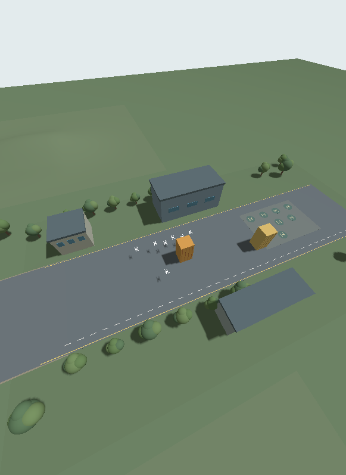

# 七机 DMPC · ROS 2 回放 + Gazebo 闭环仿真

复现「基于异构角色的分布式模型预测控制」多无人机编队方案（Zhao 等，*Chinese Journal of Aeronautics*, 2022），分两阶段：

| 阶段 | 内容 | 时间 |
|---|---|---|
| **① 算法复现 + 数据回放** | CasADi/IPOPT 求解七机 DMPC，5 组种子数据，ROS 2 + rviz2 城市回放 | 2026-11 |
| **② Gazebo 闭环仿真** | 七架缩比 X3 四旋翼在 Gazebo Harmonic 中完成起飞→编队→绕箱→归队→着陆 | 2026-11-27 |

---

## 两部分

| 目录 | 内容 | 进入 |
|---|---|---|
| `replay/` + `case-data/` | 回放节点、播放面板、5 组种子原始数据、MATLAB 验证 | [回放说明](replay/README.md) |
| `gazebo-case1/` | 七机闭环仿真：DMPC 求解、Gazebo 场景、四场单箱对照、双箱定稿 | [仿真说明](gazebo-case1/README.md) |



---

## 关键结果

### 回放阶段

| 指标 | 值 |
|---|---|
| 数据规模 | 每组 **203 帧 × 7 架**，覆盖 **0–60.6 s** |
| 首次有效分配图连通 | seed 7 在 **6.6 s** |
| 全程最小采样间距 | **118.073 m @ 11.1 s**（UAV-4 / UAV-6） |

> 该数值经**独立复算**验证：重新解析 `case-data` 中的 `states.csv`，与归档声明完全一致。过程见 [docs/独立复算.md](docs/独立复算.md)。

### Gazebo 闭环阶段

| 指标 | 值 |
|---|---|
| 完整任务时长 | **334.2 仿真秒**（起飞 → 编队 → 绕箱 → 归队 → 着陆） |
| 单箱对照 | 4 场（只改箱体横向坐标），最小障碍净距 **0.375 m** |
| 双箱定稿 | UAV-2/6 绕一号箱归队，21.4 s 后 UAV-7 绕二号箱 |

---

## 快速开始

### 看回放（只需 Python + ROS 2）

```bash
source /opt/ros/jazzy/setup.bash
python3 replay/replay_case1.py --archive "$PWD/case-data" --rviz
```

浏览器打开终端提示的地址（默认 `http://localhost:8765/`），面板支持暂停、单步、事件跳转。

### 跑 Gazebo 仿真（需 ROS 2 Jazzy + Gazebo Harmonic）

```bash
cd gazebo-case1
sudo apt install ros-jazzy-ros-gz python3-venv
python3 -m venv --system-site-packages .venv
.venv/bin/python -m pip install -r requirements.txt
gz fuel download -u 'https://fuel.gazebosim.org/1.0/OpenRobotics/models/X3 UAV/4'
bash run.sh dual
```

`bash run.sh {baseline|a|b|c|dual} [--headless]` 切换场景。详见 [gazebo-case1/README.md](gazebo-case1/README.md)。

---

## 边界说明（重要）

这个项目能做什么、不能做什么，写清楚比写漂亮重要：

| 已做到 | 未做到 |
|---|---|
| 算法复现：七机 DMPC + 异构角色协调 | 与原论文逐项数值对齐（求解器与工程补全不同） |
| 数据可复算：最小间距等指标可独立验证 | 连续时间安全性证明 |
| Gazebo 闭环：七机完整任务 334.2 仿真秒 | 高保真机型动力学（使用缩比 X3 模型） |
| 障碍绕行：基于已知静态箱体地图的逐机绕行轨迹 | **自主避障**（无在线感知、无未知障碍决策） |

**三点必须在汇报时说清**：

1. **回放 ≠ 仿真**：第一阶段只是把 CSV 数据在 rviz 里重放，没有物理引擎。
2. **预规划绕行 ≠ 自主避障**：绕行轨迹依据已知的箱体位置生成，不是在线感知决策。
3. **参数是仿真定标的**：原工程的 90 m/s、200 m 槽位间距属于其场景，本仓库使用缩比 X3 模型，速度、间距、控制约束另行标定。

---

## 目录

```
.
├─ README.md                  本文件
├─ replay/                    rviz 回放节点、播放面板、rviz 预设、机模
├─ case-data/                 seed 7–11 原始数据（states / metrics / events / summary）
├─ docs/独立复算.md            最小间距的独立复算过程
├─ gazebo-case1/              Gazebo 闭环仿真
│   ├─ case1/                 DMPC 核心、CasADi 后端、任务阶段、Gazebo 运行器
│   ├─ scenes/                baseline / a / b / c / dual 五个场景
│   ├─ results/               各场景轨迹、指标、验证结果
│   ├─ docs/                  设计历程、实验数据、复跑排查、后续验证
│   └─ media/                 截图
├─ MANIFEST.json              每个文件的 SHA-256
└─ VERIFICATION.json          归档完整性检查结果
```

---

## 引用与来源

- 论文：Zhao 等，*Chinese Journal of Aeronautics*, 2022 — [DOI](https://doi.org/10.1016/j.cja.2021.01.014)
- 课程与工具链：ROS 2 Jazzy、Gazebo Harmonic、CasADi 3.7、Open Robotics X3 UAV 模型
- 第三方代码与资产来源见 [gazebo-case1/NOTICE.md](gazebo-case1/NOTICE.md)

许可证：Apache-2.0
