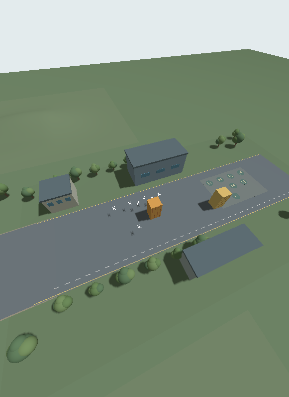

# 七机 DMPC · ROS 2 / Gazebo 闭环仿真

从开阔停机坪起飞，转入道路上空，按 Case 1 的初始机位和角色规则完成编队，再沿同一条任务流程绕箱、归队和着陆。最终双箱场景在 Gazebo 中完成了七架机的完整飞行，起飞控制到落地停稳共 **334.2 仿真秒**。



## 四组单箱对照

前四组只改变箱体横向坐标。冻结版数据显示，其余三组相同的 Case 1 过程和控制配置可以用来比较绕行机号与净距。箱体纵向坐标均为 58.10 m。

| 运行参数 | 箱体 y（m） | 绕行飞机 | 最小障碍净距（m） | 绕行段最小采样机间距（m） |
|---|---:|---|---:|---:|
| `baseline` · 冻结版第 4 轮 | 0.000 | UAV-1、3、4、5 | 0.375 | 1.980 |
| `a` · 中间航线 | −1.732 | UAV-2、6 | 0.375 | 1.046 |
| `b` · 最外侧航线 | −3.464 | UAV-7 | 0.375 | 1.046 |
| `c` · 缩小绕行净距 | +0.160 | UAV-1、3、4、5 | 0.215 | 1.989 |

`dual` 为独立的最终定稿。UAV-2 和 UAV-6 绕过一号箱并归队，七机沿各自航线继续飞行 **21.4 仿真秒** 后，UAV-7 开始绕二号箱。两个箱体的最小净距均约为 **0.375 m**，最后七架机分别停在七个标记上。

## 复跑

使用 Ubuntu 24.04、ROS 2 Jazzy 和 Gazebo Harmonic。安装 ROS 2 Jazzy 后，使用对应的 `ros_gz` 套件。 [Gazebo 与 ROS 安装说明](https://gazebosim.org/docs/harmonic/ros_installation/)

```bash
cd gazebo-case1
sudo apt install ros-jazzy-ros-gz python3-venv
source /opt/ros/jazzy/setup.bash
python3 -m venv --system-site-packages .venv
.venv/bin/python -m pip install -r requirements.txt
gz fuel download -u 'https://fuel.gazebosim.org/1.0/OpenRobotics/models/X3 UAV/4'
bash run.sh dual
```

首次运行从 Gazebo Fuel 获得 Open Robotics X3 UAV 第 4 版。已有同一版本的缓存时可直接进入最后一步。启动器会校验模型指纹，替换机身和旋翼的显示网格，再用该目录中的五个场景模板和地图配置启动 Gazebo。 `X3_MODEL_SDF` 可指定同版本 `model.sdf`， `CASE1_PYTHON` 可选已有的 ROS 兼容虚拟环境。

- 用 `bash run.sh a`、`b`、`c` 或 `baseline` 切换场景。
- 用 `bash run.sh dual --headless` 无界面跑完整任务。带窗口的自动复跑可加 `--exit-on-finish`。
- 轨迹默认写入 `runs/`。用 `--output DIR` 指定新的输出目录。已有同一 ROS 域的演示时，可用 `ROS_DOMAIN_ID` 指定另一域。
- WSL 已验证的 NVIDIA 渲染用法见[复跑与排查](docs/reproduce.md)。

## 资料索引

- [设计思路、实现历程和修正记录](docs/process.md)
- [实验数据、四场景小结与双箱定稿](docs/experiments.md)
- [复跑、排查和归档说明](docs/reproduce.md)
- [优化建议与后续验证](docs/roadmap.md)
- [代码与资产来源](NOTICE.md)
- [早期程序与阶段文字记录](history/README.md)

原论文提出基于异构角色的分布式协调方案。工程复现采用 CasADi/IPOPT，并在 Gazebo 中使用缩比的 X3 四旋翼模型。避障阶段依据已知静态箱体地图生成逐机绕行轨迹。现有结论来自仿真采样。 [Zhao 等，Chinese Journal of Aeronautics，2022](https://doi.org/10.1016/j.cja.2021.01.014)
