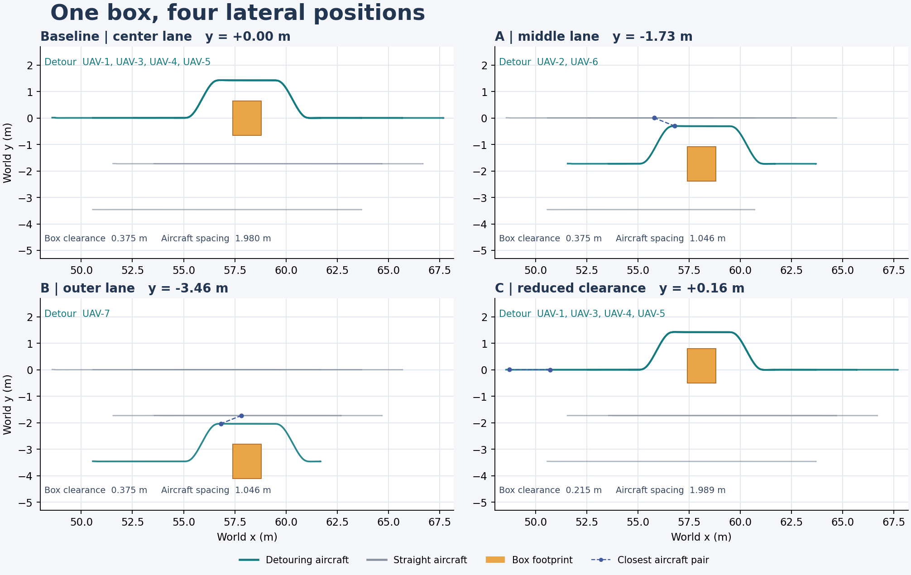
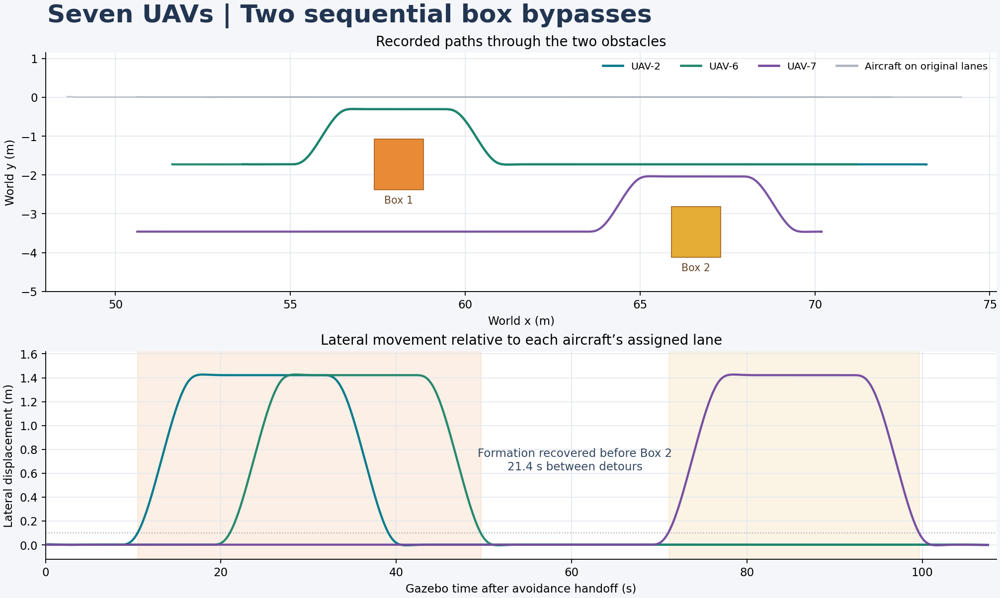

# 实验配置与结果

## 空场 Case 1

工程对照基线使用 seed 7。空间比例为 1:100，Case 1 的 0.30 s 控制间隔对应 0.90 仿真秒。表中箱体位置和距离使用 Gazebo 的米制尺度。

空场闭环触发了 **S2 (UAV-4, UAV-5)、S5 (UAV-2, UAV-6)、S6 (UAV-3, UAV-6)、S6 (UAV-3, UAV-4)、S6 (UAV-4, UAV-6)**。最终七机连通，得到与 seed 7 工程基线一致的 14 条有向槽位。空场趋近阶段的最终最大槽位误差约 0.0123 m，最小采样机间距为 1.4679 m。 [空场摘要](../results/open-field/summary.json)

## 冻结版四次复跑

| 轮次 | 全流程仿真时间（s） | 成队最小采样间距（m） | 最近时刻（Case 1 s） | 整组求解峰值（ms） | 单机回退 |
|---|---:|---:|---:|---:|---:|
| 1 | 299.60 | 1.471 | 11.7 | 361 | 2 |
| 2 | 299.40 | 1.451 | 12.0 | 352 | 7 |
| 3 | 299.82 | 1.439 | 12.0 | 231 | 4 |
| 4 | 299.40 | 1.436 | 12.0 | 350 | 6 |

4/4 完成原角色事件、绕箱、归队和七机着陆。最近机对都是 UAV-4 与 UAV-6，各轮最小间距极差约 0.035 m。最终槽位误差约 0.016–0.019 m。单机回退均为 `Maximum_Iterations_Exceeded`，UAV-4 有 10 次，UAV-5 有 9 次，其中 18 次在 Case 1 的 6.6–7.5 s。 [冻结复跑对照](../results/frozen/comparison.csv) · [单机回退汇总](../results/frozen/summary.json)

## 四个单箱场景

| 场景 | 箱体横坐标 x / y（m） | 实际绕行飞机 | 最小箱体净距（m） | 绕行段最小采样机间距（m） | 全任务仿真秒 |
|---|---|---|---:|---:|---:|
| 冻结版第 4 轮 | 58.10 / 0.000 | UAV-1、3、4、5 | 0.375 | 1.980 | 299.40 |
| A · 中间航线 | 58.10 / −1.732 | UAV-2、6 | 0.375 | 1.046 | 291.42 |
| B · 外侧航线 | 58.10 / −3.464 | UAV-7 | 0.375 | 1.046 | 294.68 |
| C · 箱体靠近绕行侧 | 58.10 / +0.160 | UAV-1、3、4、5 | 0.215 | 1.989 | 299.38 |

冻结版是四场景对照中的基准，四轮复跑用于检查它的重复性。A 验证两架原本直飞的飞机转为绕行。B 验证侧翼单机独立偏出。两组都把箱体净距保持在约 0.375 m，同时把相邻航线上的机间距压缩到约 1.046 m。A 的最近机对为 UAV-2/UAV-3，B 为 UAV-6/UAV-7。C 保持原四架机绕行，箱体向绕行侧移 0.16 m，最小净距随之减少约 0.16 m。各变体各完成一次该配置的完整仿真。 [变体原始汇总](../results/single-box/comparison.csv)

## 双箱最终场景

两个箱体纵向相隔 8.50 m。下面的时间从切换到避障控制起算。回位和离开原航线用 0.10 m 的横向偏差阈值统计。

| 障碍 | 世界坐标 x / y（m） | 实际绕行飞机 | 开始绕行 / 回位（s） | 最小净距（m） | 绕行段最小机间距（m） |
|---|---|---|---|---:|---:|
| 一号箱 | 58.10 / −1.732 | UAV-2、UAV-6 | 10.5 / 49.7 | 0.375 | 1.046 |
| 二号箱 | 66.60 / −3.464 | UAV-7 | 71.1 / 99.7 | 0.375 | 1.046 |

一号箱回位到二号箱触发之间，七架机的横向偏差均不超过 0.10 m，间隔 **21.4 s**。避障段持续 **107.5 s**，从起飞控制开始到七架机停稳共 **334.2 s**。仓库版的独立目录复跑另见[发布验证记录](../results/release-validation.json)。 [定稿验证](../results/dual/verification.json)

## 复算口径与原始资料

- 采样机间距为同一采样时刻所有 21 对机心三维距离的最小值。
- 估算障碍净距为机心到实体箱体的最短距离减去设置的 0.40 m 机体包络半径。
- `formation/events.csv` 记录事件、触发机对和槽位。 `formation/metrics.csv` 与 `formation/states.csv` 支持复算成队间距、槽位误差和求解时间。
- `avoidance/states.csv`、`approach_states.csv`、`landing_states.csv` 分别保存逐机绕行、起飞进场和落地位姿。
- 仿真结果用于同一环境下的工程对照。连续时间安全界、真实机体性能、动态障碍和传感误差仍属于后续验证范围。
